# Walmart Data Engineering Pipeline

An end-to-end Data Engineering project that builds a local analytics pipeline using **Apache Airflow, dbt, PostgreSQL, Docker, Python, and SQL**.

The pipeline ingests Walmart retail data into PostgreSQL, orchestrates transformations with Airflow, applies layered dbt transformations, validates data quality, creates dimensional models, and produces a final analytics-ready fact table.

---

## Project Architecture

```mermaid
flowchart LR
    A[Walmart CSV Files] --> B[Python Data Loader]
    B --> C[(PostgreSQL - Public Schema)]

    C --> D[Apache Airflow]

    D --> E[dbt Source Freshness]
    E --> F[Silver Technical Layer]
    F --> G[dbt Tests]
    G --> H[Silver Business Layer]
    H --> I[dbt Tests]

    I --> J[Gold Ephemeral Models]
    J --> K[Gold Dimension Snapshots]
    K --> L[Gold Fact Model]

    L --> M[(gold.fact_orders)]
```



---

## Technology Stack

| Tool | Purpose |
|---|---|
| **Python** | Load Walmart CSV data into PostgreSQL |
| **PostgreSQL** | Source database and analytical data store |
| **Apache Airflow** | Pipeline orchestration and task scheduling |
| **dbt Core** | SQL transformation framework |
| **dbt-postgres** | PostgreSQL adapter for dbt |
| **SQL** | Data transformation and analytical modeling |
| **Docker** | Containerized Airflow environment |
| **Docker Compose** | Runs Airflow, PostgreSQL and supporting services |
| **Redis** | Airflow supporting service |
| **Git** | Source control |
| **GitHub** | Project repository and version management |
| **VS Code** | Development environment |

---

## Pipeline Flow

The Airflow DAG orchestrates the full dbt transformation pipeline.

```text
ingest_cdc
     ↓
clean_target
     ↓
source_freshness
     ↓
silver_technical
     ↓
silver_technical_tests
     ↓
silver_business
     ↓
silver_business_tests
     ↓
gold_ephemeral
     ↓
gold_dimensions
     ↓
gold_facts
```

A successful pipeline run executes all transformation and validation stages sequentially.

---

## Airflow Pipeline

The project uses an Apache Airflow DAG named:

```text
orchestrate
```

The DAG performs:

1. Local ingestion initialization
2. dbt target cleanup
3. Source freshness validation
4. Silver technical transformations
5. Silver technical tests
6. Silver business transformations
7. Silver business tests
8. Gold ephemeral transformations
9. Dimension snapshots
10. Fact table creation

### Successful Airflow Run

Add your successful Airflow screenshot to:

```text
images/airflow_pipeline_success.png
```

Then this image will display automatically:

```markdown

```

---

# Data Architecture

The database follows a layered transformation architecture.

## Source Layer

Raw Walmart data is loaded into the PostgreSQL `public` schema.

Source tables:

```text
public.customers
public.employees
public.order_items
public.orders
public.products
public.stores
```

---

## Silver Technical Layer

Schema:

```text
silver_t
```

Models:

```text
silver_t.customers_t
silver_t.employees_t
silver_t.order_items_t
silver_t.orders_t
silver_t.products_t
silver_t.stores_t
```

The technical layer performs standardized transformations and prepares source data for downstream modeling.

---

## Silver Business Layer

Schema:

```text
silver_b
```

Main model:

```text
silver_b.obt_b
```

This model creates a business-oriented joined dataset combining:

- Orders
- Customers
- Products
- Employees
- Stores
- Order Items

---

## Gold Layer

Schema:

```text
gold
```

### Dimension Tables

```text
gold.dim_customers
gold.dim_employees
gold.dim_orders
gold.dim_products
gold.dim_stores
```

These tables are generated using **dbt snapshots** to support historical dimensional tracking.

### Fact Table

```text
gold.fact_orders
```

Final verified row count:

```text
300,513 rows
```

The fact table contains analytical measures and foreign keys including:

```text
order_id
order_item_id
product_id
store_id
employee_id
customer_id
total_amount
quantity
unit_price
line_amount
```

---

# dbt Project

The dbt project is located at:

```text
airflow_dbt_project/walmart_project/
```

dbt is used for:

- Source definitions
- Incremental models
- Business transformations
- Data tests
- Ephemeral models
- Snapshots
- Fact and dimension modeling

---

## Source Configuration

dbt reads the source tables from:

```text
Database: walmart_db
Schema: public
```

Example:

```yaml
sources:
  - name: walmart_databricks
    database: walmart_db
    schema: public
```

The source name is retained from the project structure while the implementation runs locally on PostgreSQL.

---

# Database Schemas

The completed PostgreSQL environment contains:

```text
public
silver_t
silver_b
gold
```

Verified using:

```bash
psql walmart_db -c "\dn"
```

---

# Final Output Validation

Gold dimension tables:

```bash
psql walmart_db -c "\dt gold.*"
```

Fact table:

```bash
psql walmart_db -c "\dt gold.fact*"
```

Fact row count:

```bash
psql walmart_db -c "SELECT COUNT(*) FROM gold.fact_orders;"
```

Result:

```text
300513
```

---

# Project Structure

```text
Walmart_Airflow_DBT_Project/
│
├── airflow_dbt_project/
│   │
│   ├── dags/
│   │   └── orchestrate.py
│   │
│   ├── config/
│   │   └── airflow.cfg
│   │
│   ├── walmart_project/
│   │   │
│   │   ├── models/
│   │   │   ├── source/
│   │   │   ├── silver_t/
│   │   │   ├── silver_b/
│   │   │   └── gold/
│   │   │
│   │   ├── snapshots/
│   │   ├── tests/
│   │   ├── macros/
│   │   ├── profiles.yml
│   │   └── dbt_project.yml
│   │
│   ├── Dockerfile
│   ├── docker-compose.yaml
│   └── requirements.txt
│
├── walmart_dataset/
│   │
│   ├── data/
│   │   ├── customers.csv
│   │   ├── employees.csv
│   │   ├── order_items.csv
│   │   ├── orders.csv
│   │   ├── products.csv
│   │   └── stores.csv
│   │
│   ├── ddl/
│   │   └── walmart_schema.sql
│   │
│   └── load_data.py
│
└── README.md
```

---

# Local Setup

## 1. Clone the Repository

```bash
git clone https://github.com/kanimozhijayakumar/Walmart_Airflow_DBT_Project.git

cd Walmart_Airflow_DBT_Project
```

---

## 2. Create PostgreSQL Database

```bash
createdb walmart_db
```

---

## 3. Create Source Tables

```bash
psql walmart_db < walmart_dataset/ddl/walmart_schema.sql
```

---

## 4. Install Python Dependency

```bash
python3 -m pip install psycopg2-binary
```

---

## 5. Load Walmart Dataset

```bash
cd walmart_dataset

python3 load_data.py
```

Example validation:

```bash
psql walmart_db -c "SELECT COUNT(*) FROM orders;"
```

---

## 6. Start Airflow

Move to the Airflow project:

```bash
cd ../airflow_dbt_project
```

Build containers:

```bash
docker compose build
```

Start Airflow:

```bash
docker compose up -d
```

Check container status:

```bash
docker compose ps -a
```

---

## 7. Open Airflow

Open:

```text
http://localhost:8080
```

Select:

```text
orchestrate
```

and trigger the DAG.

---

# Data Quality

The pipeline includes dbt tests after both Silver transformation stages.

```text
silver_technical
        ↓
silver_technical_tests

silver_business
        ↓
silver_business_tests
```

This prevents downstream Gold models from executing when upstream data quality checks fail.

---

# dbt Snapshots

Gold dimensions use dbt snapshots to preserve historical changes.

Example configuration:

```yaml
strategy: timestamp
updated_at: customer_updated_timestamp
dbt_valid_to_current: "DATE '9999-12-31'"
```

This enables Slowly Changing Dimension-style historical tracking.

---

# Key Engineering Concepts Demonstrated

This project demonstrates practical Data Engineering concepts including:

- ETL / ELT pipeline design
- Workflow orchestration
- Dockerized data platforms
- Incremental dbt models
- Source freshness validation
- Automated data quality testing
- Layered data architecture
- Business transformation modeling
- Fact and dimension modeling
- dbt snapshots
- PostgreSQL analytics
- Pipeline debugging
- Dependency management
- Git version control

---

# Project Result

The completed pipeline successfully transforms raw Walmart retail data into analytics-ready dimensional models.

Final Gold outputs include:

```text
5 Dimension Tables
1 Fact Table
300,513 Fact Records
```

All tasks in the final Airflow DAG run completed successfully.

---

## Future Enhancements

Potential extensions include:

- Add Power BI or Tableau dashboard
- Add Great Expectations data quality checks
- Add CI/CD using GitHub Actions
- Add cloud deployment on AWS
- Add S3 ingestion
- Add incremental CDC ingestion
- Add monitoring and alerting
- Add Airflow scheduling
- Add dimensional KPI dashboards

---

## Project Background

This implementation was substantially adapted and reworked for a local **PostgreSQL + Airflow + dbt** environment, including database connectivity, SQL compatibility changes, orchestration fixes, dbt adapter configuration, snapshot configuration, and end-to-end validation.
